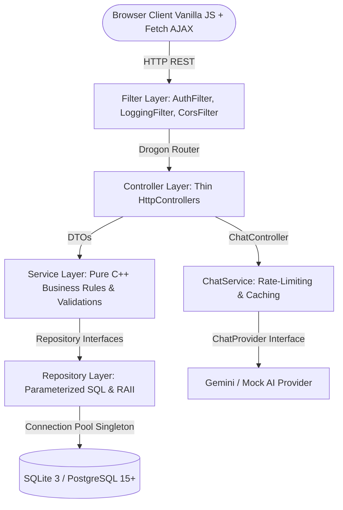

# SudharshanMart — Native C++20 Marketplace Platform

[](https://en.cppreference.com/w/cpp/20)
[](https://drogon.org)
[]()
[]()

> **Capstone Project — Native C++20 Equivalent of the Servlets/JDBC Enterprise Capstone**  
> **Project Owner & Architect:** Sudharshan  
> **Namespace:** `sudharshan::sudharshanmart`  
> **Database:** `sudharshanmart.db` / PostgreSQL  

---

## 🚀 Overview

**SudharshanMart** is an enterprise-grade, multi-seller e-commerce web platform powered by a native C++20 HTTP backend utilizing the high-performance **Drogon** framework. It bridges web architectures with native systems programming, featuring:

- **Strict Multi-Tier Clean Architecture**: Clear separation of Filters, Controllers, Services, Repositories, and Entities.
- **Dependency Inversion (SOLID)**: Pure C++ service layers interact solely with abstract repository interfaces (`std::shared_ptr<I...Repository>`).
- **Financial Precision**: Money encapsulated in minor units (`BIGINT` cents) via a dedicated `Money` value type—no floating-point leaks.
- **Rigorous Security**: Argon2id password hashing via libsodium (`crypto_pwhash_str`), 100% parameterized queries (zero SQL injection), HTML sanitization, and session fixation defense.
- **Real-Time AI Assistant**: Swappable LLM Chatbot (`GeminiChatProvider` / `MockChatProvider`) via the Factory Pattern with in-memory caching and session rate limiting (10 req/min).

---

## 🏛️ System Architecture



### Module Directory Structure
```
sudharshan/
├── CMakeLists.txt                # C++20 CMake build configuration
├── vcpkg.json                    # Dependency manifest (Drogon, libsodium, spdlog, sqlite3)
├── Dockerfile                    # Multi-stage production container
├── docker-compose.yml            # Container orchestration
├── server.py                     # Standalone instant dev server runner
├── db/
│   ├── schema.sql                # Complete relational schema
│   ├── seed.sql                  # Seed rows (Sudharshan Admin, Sellers, Buyers)
│   └── migrations/               # Numbered migrations (V1, V2, V3)
├── public/                       # Responsive Web Interface
│   ├── index.html                # Single-page application structure
│   ├── css/style.css             # Glassmorphism dark-theme styling
│   └── js/app.js                 # AJAX orchestration & state management
├── src/
│   ├── main.cc                   # Application entrypoint & dependency wiring
│   ├── ai/                       # AI Chat Provider interface & factory
│   ├── controller/               # Thin Drogon HTTP controllers
│   ├── dto/                      # Data Transfer Objects & ApiResponse envelope
│   ├── exception/                # AppException hierarchy & GlobalErrorHandler
│   ├── filter/                   # Logging, Auth, and CORS filters
│   ├── model/                    # POD entities & Money value type
│   ├── plugin/                   # DbPlugin & MigrationPlugin lifecycles
│   ├── repository/               # Repository interfaces, SQLite impl, Factory
│   ├── service/                  # Business logic & validations
│   └── util/                     # Argon2id PasswordUtil & ValidationUtil
└── test/                         # GoogleTest unit & integration suites
```

---

## 🎯 Features Implemented

### Mandatory Core Features (F1 – F8)
- [x] **F1: User Registration & Login**: Distinct roles (`BUYER`, `SELLER`, `ADMIN`). Buyer and seller self-registration; admin creation uses the explicit environment-backed CLI. Argon2id password hashing via libsodium.
- [x] **F2: Seller Management**: Sellers create, edit, and delete product listings (`name`, `description`, `price_cents`, `stock_qty`, `category`, `image_url`).
- [x] **F3: Buyer Discovery**: Keyword search and category filtering with instant dynamic re-rendering.
- [x] **F4: Shopping Cart**: Add to cart, quantity increments/decrements, item removal, and live running total calculations.
- [x] **F5: Mock Checkout**: Seamless checkout placing orders atomically with mock payment confirmations (UPI, Card, NetBanking).
- [x] **F6: Order History**: Buyer view of past orders; Seller view of incoming customer orders.
- [x] **F7: Admin Governance**: Platform admin portal to view all users, review orders, and moderate inappropriate product listings.
- [x] **F8: Customer Reviews**: Star ratings (1–5) and feedback submitted strictly for verified completed purchases.

### Bonus / Advanced Features (O1 – O4)
- [x] **O1: Wishlist / Save-for-Later**: Schema and API endpoints for personal item bookmarking.
- [x] **O2: Order Workflow**: Multi-state order lifecycle (`PENDING` → `CONFIRMED` → `SHIPPED` → `DELIVERED`).
- [x] **O3: Seller Sales Dashboard**: Real-time sales metrics computing total fulfilled orders and revenue in INR.
- [x] **O4: AI Chatbot Assistant**: Floating UI widget powered by `ChatProvider` with thread-safe rate limiting (10 req/min) and session question caching.

---

## 🛠️ Design Patterns Applied (Section 10)

| Pattern | Location | Purpose |
| :--- | :--- | :--- |
| **Repository** | `src/repository/` | Abstract data access behind pure virtual interfaces |
| **Front Controller** | `BaseController`, Drogon Router | Centralize session validation and error translation |
| **Singleton** | `DatabaseConnection`, `DbPlugin` | Manage shared database connection instance and pool |
| **Factory** | `RepositoryFactory`, `ChatProviderFactory` | Decouple concrete instantiations from consumers |
| **Strategy** | `ChatProvider` (`Gemini` / `Mock`) | Swappable AI response engines selected by config flag |
| **Builder** | `UserResponseDto::Builder`, `CartSummaryResponseDto::Builder` | Fluent DTO construction |
| **Dependency Injection** | All Services (`AuthService`, `ProductService`, etc.) | Manual constructor injection of repository interfaces |

---

## ⚡ Quick Start & Execution

### Local environment configuration
Copy `.env.example` to `.env` and edit only the values you need. The native server loads `.env` at startup for local development. Variables already provided by your shell or hosting platform take precedence; `.env` only supplies missing values.

Supported variables:

| Variable | Default | Purpose |
| --- | --- | --- |
| `PORT` | `8080` | HTTP listener port (binds to `0.0.0.0`) |
| `DB_PATH` | `sudharshanmart.db` | SQLite database file. `.env.example` uses `./data/sudharshanmart.db`. |
| `DATABASE_URL` | unset | Server-only PostgreSQL URI; use Neon for deployment. If set, invalid/non-PostgreSQL URLs fail startup. |
| `REQUIRE_POSTGRES` | `false` | Set `true` to fail startup instead of silently falling back to SQLite. |
| `AI_CHATBOT_PROVIDER` | `mock` | Chat provider: `mock` or `gemini` |
| `GEMINI_API_KEY` | empty | Optional server-side key when Gemini is intentionally enabled |
| `ADMIN_EMAIL`, `ADMIN_PASSWORD` | unset | Required only for explicit admin seed or password reset; never commit values |
| `ADMIN_NAME` | SudharshanMart Administrator | Optional display name for a newly seeded admin |

Keep `.env` local; it is ignored by Git and excluded from Docker builds. Do not place secrets in frontend files.

### Render deployment
Create a Docker Web Service from this repository. The production image requires PostgreSQL (`REQUIRE_POSTGRES=true`) and runs the versioned migrations before listening. In the Render dashboard, copy the connection URI from the intended Neon project and branch (choose the production database, usually `neondb`) into the private `DATABASE_URL` environment variable. Do not include that URI in build arguments or frontend variables. Configure the following:

| Key | Value |
| --- | --- |
| `PORT` | `8080` |
| `DATABASE_URL` | Neon connection URI (`postgresql://…`) for the intended Neon branch/database |
| `REQUIRE_POSTGRES` | `true` |
| `AI_CHATBOT_PROVIDER` | `mock` |

The previous runtime silently chose SQLite whenever neither PostgreSQL URL variable was set. That lets the app appear to run while Neon remains empty. The production image now fails at startup when `DATABASE_URL` is missing, and it rejects other URL schemes instead of silently falling back. PostgreSQL connections also set `search_path` to `public`, so the migration target is explicit.

`DATABASE_URL` must use `postgres://` or `postgresql://`; the server selects it instead of SQLite and explicitly sets PostgreSQL `search_path` to `public`. At startup it applies pending migrations transactionally under a PostgreSQL advisory lock and fails before serving if any required table is missing. Check `/api/v1/health` or run `/opt/sudharshanmart/bin/sudharshanmart --check-db` from Render Shell to see backend, database, schema, and table count without credentials. Run `/opt/sudharshanmart/bin/sudharshanmart --migrate` for a one-off migration; startup also runs migrations before accepting requests. The local `.env` in this workspace has no PostgreSQL URL, so it uses SQLite; Neon connectivity and live table creation cannot be confirmed until the Render secret is configured. Never upload `.env` to Render. Add `GEMINI_API_KEY` only if Gemini is intentionally enabled. Admin accounts are never created from public registration or seeded with source-controlled passwords.

To seed the first admin, add `ADMIN_EMAIL` and `ADMIN_PASSWORD` as private service environment variables in Render, deploy, then use the service Shell:

```sh
/opt/sudharshanmart/bin/sudharshanmart --seed-admin
```

The command connects to the configured production `DATABASE_URL`, applies pending migrations, verifies the required schema, and safely seeds the admin. Repeating it with the same existing admin credentials is safe. If an admin exists with a different password, it fails without changing privileges; explicitly use `--reset-admin-password` to rotate that account's password. It refuses to promote a buyer or seller. Remove `ADMIN_PASSWORD` from Render after the operation unless you are rotating credentials. For the legacy seeded admin row, confirm `ADMIN_EMAIL` matches that existing ADMIN account and use the explicit reset command. Existing data is retained.

For local Docker, run these commands from the project root (the PowerShell form works in Windows PowerShell):

```powershell
docker build -t sudharshanmart .
New-Item -ItemType Directory -Force data
docker run --rm -p 8080:8080 -e PORT=8080 -e REQUIRE_POSTGRES=false -e DB_PATH=/var/data/sudharshanmart.db -e AI_CHATBOT_PROVIDER=mock -v "${PWD}/data:/var/data" sudharshanmart
```

Check `http://localhost:8080/api/v1/health` and `http://localhost:8080/` after startup. Run `docker run` again with the same `data` directory to confirm the database persists.

### Option 1: Instant Local Runner (Windows / macOS / Linux)
SudharshanMart includes an interactive standalone runner using Python:
```bash
python server.py
```
Visit **`http://localhost:8080`** in any web browser.

### Option 2: Native C++20 Compilation
```bash
# Install dependencies
vcpkg install

# Configure and build
cmake -B build -G Ninja -DCMAKE_BUILD_TYPE=Release
cmake --build build --config Release

# Run automated tests
cd build && ctest --output-on-failure

# Launch Native Drogon server
./build/sudharshanmart
```

### Option 3: Docker Multi-Stage Container
```bash
docker-compose up --build
```

---

## 🔐 Security & Engineering Rigor
- **100% Parameterized SQL**: Every query uses SQLite prepared statements via `sqlite3_bind_*`—zero raw SQL concatenation.
- **Argon2id Hashing**: High-entropy password hashing with CPU/memory cost parameters via libsodium.
- **Zero Leakage**: `UserResponseDto` strictly omits `password_hash`. `GlobalErrorHandler` catches exceptions and returns standardized error envelopes without stack traces.
- **Money Safety**: Arithmetic prohibited on raw integer primitives; strictly governed by `Money` value type.
